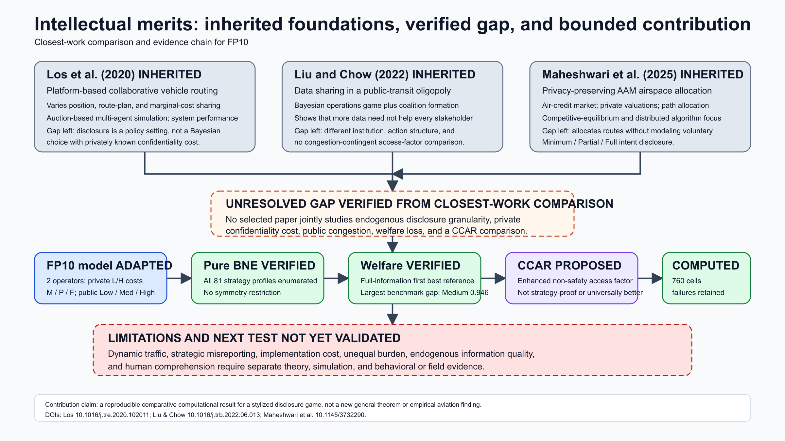
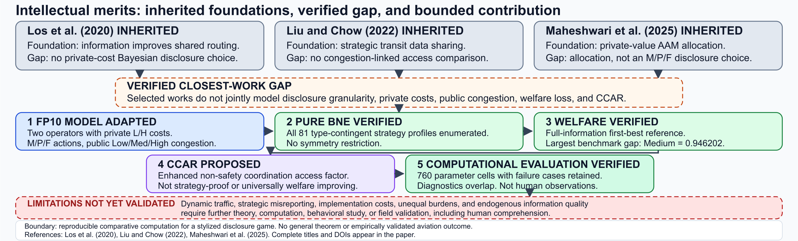
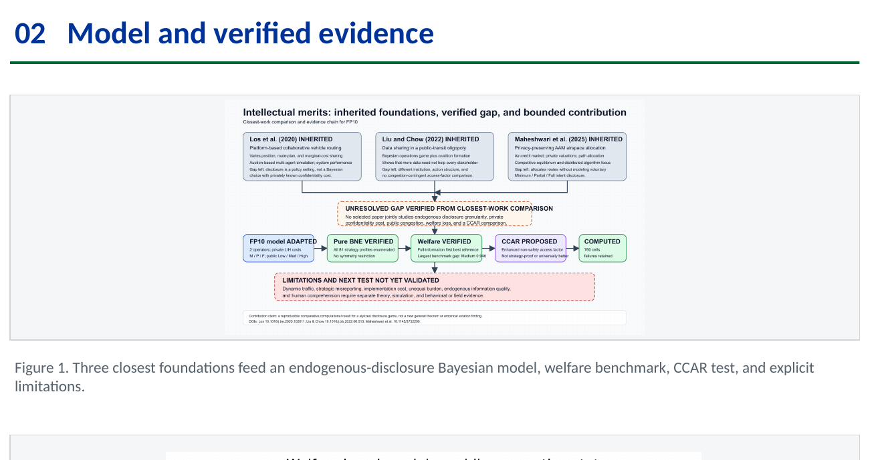
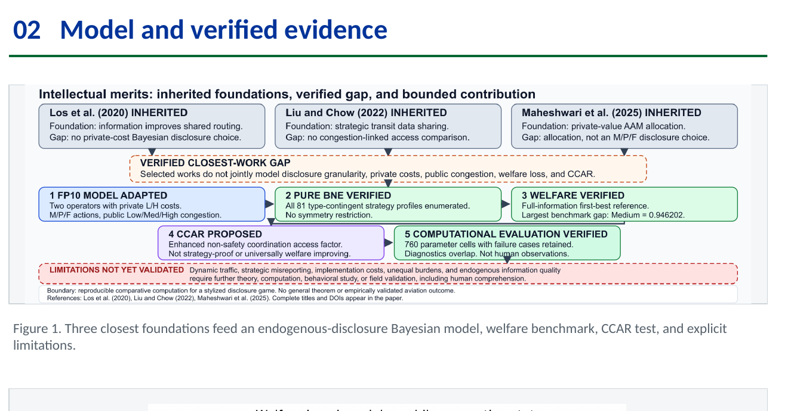
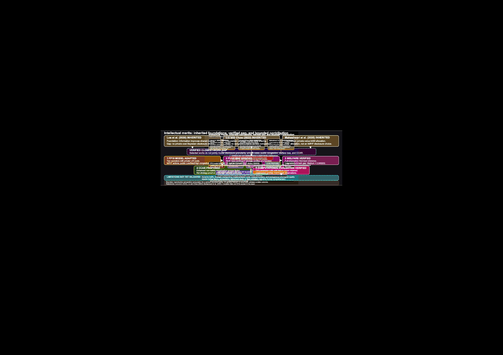

# Intellectual Merits visual-fix audit

Audit date: 2026-10-15, Asia/Shanghai. Scope: the Intellectual Merits diagram and its legitimate final-release consumers only.

## Root cause

The former `1600 × 900` (16:9) diagram was inserted with `contain` into a `1664 × 470` ultra-wide poster slot. The fitted image occupied only about half the slot width, leaving roughly 414 poster units of blank space on each side. Its 15 px body text consequently rendered at approximately 5.9 pt on the A0 poster. The defect was an aspect-ratio and information-density mismatch, not a scientific-content error.

## Surgical redesign

- Rebuilt the source as a `1800 × 544` wide information chain while retaining the three cited foundations, the bounded closest-work gap, the adapted model, verified pure-BNE enumeration, verified welfare comparison, proposed CCAR, computational evaluation, limitations, and contribution boundary.
- Established a four-level reading order: literature foundations → closest-work gap → numbered 1–5 research pipeline → limitations and boundary.
- Used three equal literature cards, a centered orange dashed gap, a numbered `3 + 2` pipeline, and a red dashed limitation boundary. Color semantics explicitly distinguish inherited, adapted, verified, proposed, and not-yet-validated claims.
- Kept all substantive quantities and boundaries unchanged, including the 81 strategy profiles, the largest benchmark gap of `0.946202`, the 760 parameter cells, overlapping diagnostics, and the statement that results are not human observations.

## Geometry, typography, and containment

- Canonical SVG viewBox: `1800 × 544`; exported PNG: `2400 × 725`; exported PDF: `1350 × 408 pt`.
- Poster embedding box: left `1415`, top `1170`, width `1664`, height `490`, fully inside the original Section 02 research-design area (`x=1400`, `y=1170`, `w=1693.86`, `h=490`). The Section 02 heading and divider geometry were not changed.
- Effective poster typography is approximately `17.70 pt` for literature headings, `14.97 pt` for literature/gap body text, `16.34 pt` for pipeline headings, `13.61 pt` for pipeline body text, `12.25 pt` for limitations, and `10.89 pt` for boundary/reference microcopy.
- Programmatic geometry validation reports `PASS`: 11 cards, 9 connectors, no text overflow, no text-text collision, no card overlap, no connector/text intersection, and no out-of-viewBox content.
- Full-poster pixel comparison at `3371 × 2384` detected 316,172 changed pixels inside the intended Intellectual Merits image region and exactly 0 changed pixels outside it; maximum outside-channel delta is 0.

## Before and after

### Diagram

Before:

After:

### Poster Section 02

Before:

After:

Pixel difference (black outside the changed target region):

## Cross-artifact synchronization

- Canonical SVG/PDF/PNG exports were regenerated from one source with preserved aspect ratio.
- The editable poster was rebuilt from the canonical PNG, validated as one A0 landscape slide, and exported to matching final PDF/PNG deliverables. The stable poster and Canvas-copy PPTX hashes match; their PDF hashes also match.
- The paper figure copy is byte-identical to the canonical diagram PDF. The appendix caption was updated only to match the new visual semantics.
- The paper compiles successfully with TeX Live 2026 to seven A4 pages. The required main paper remains pages 1–2, Author Notes begins on page 3, and the enlarged appendix figure is unclipped.
- The built-in standalone editor compiler could not stage the paper's project-relative figure assets; the full project was therefore compiled with the repository-aware LaTeX workflow. This was a staging limitation, not a TeX source error.
- The Overleaf ZIP was rebuilt from the exact final source set and compiled independently in a clean temporary directory to the same seven-page A4 output. Its Intellectual Merits PDF hash matches the canonical figure.

## Preserved scope

No model definitions, equations, data, references, DOIs, results, notebooks, website files, other poster sections, poster title/acknowledgments/QR codes, or historical artifacts were changed. Untracked user files under `othres/` and `submission/` were preserved and excluded from the release change.

## Evidence

- `outputs/final/intellectual_merits_geometry.json`: DOM/SVG geometry and effective font-size evidence.
- `outputs/final/intellectual_merits_poster_diff.json`: target-region pixel-difference evidence.
- `outputs/final/final_release_check.json`: final structural, artifact, synchronization, and release checks.

## Remaining human checks

Open the final PPTX in Microsoft PowerPoint to confirm native font rendering, QR scanning, hyperlinks, and print preview; inspect both final PDFs at 100%; approve the scientific wording and authorship details; then upload the four files in `submission/final/` to Canvas.
