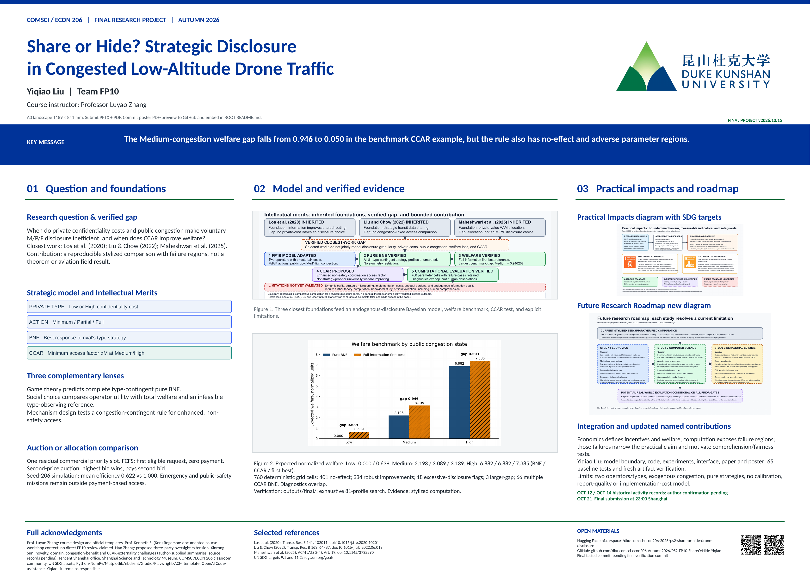
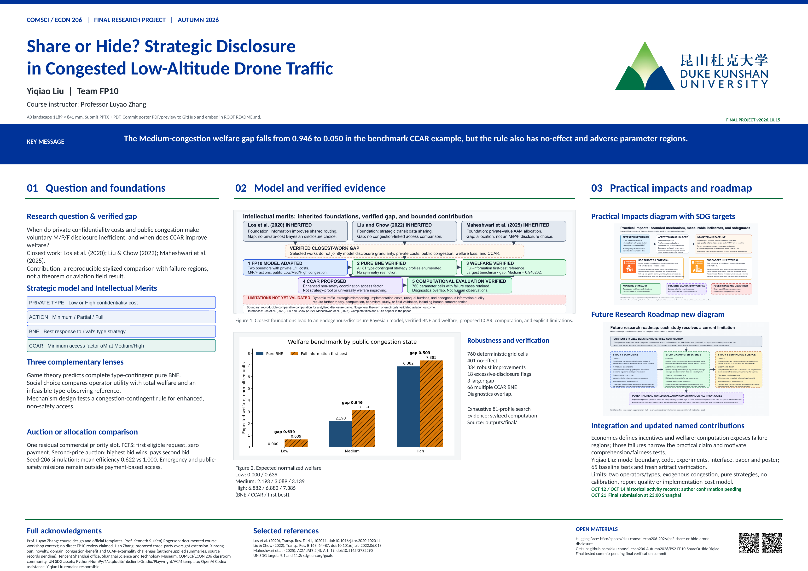
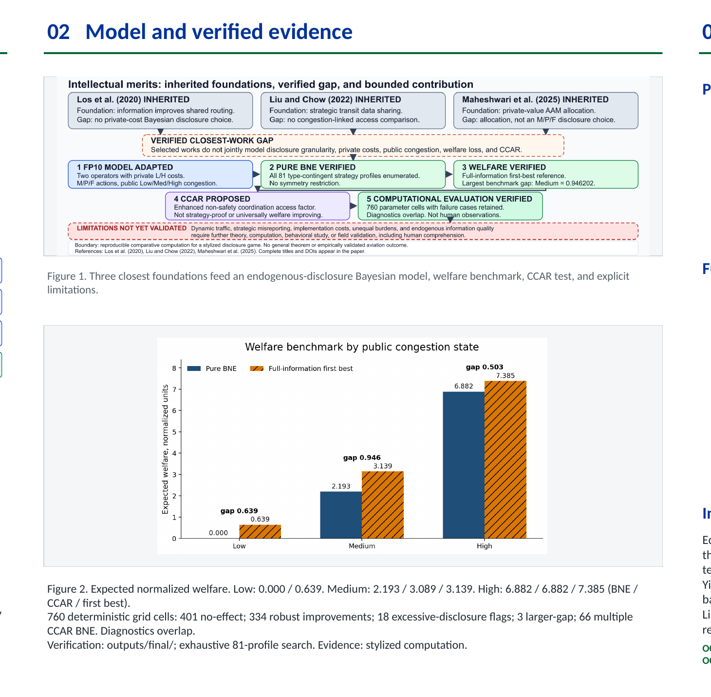
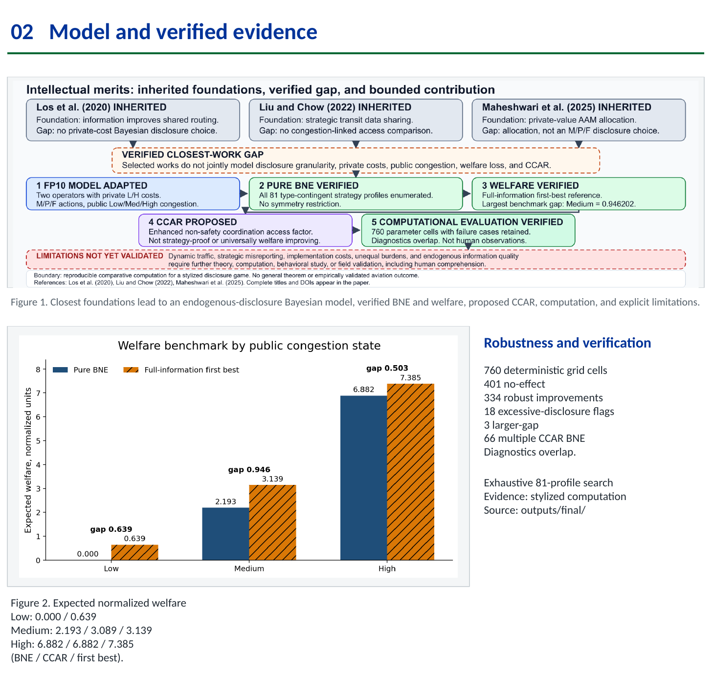
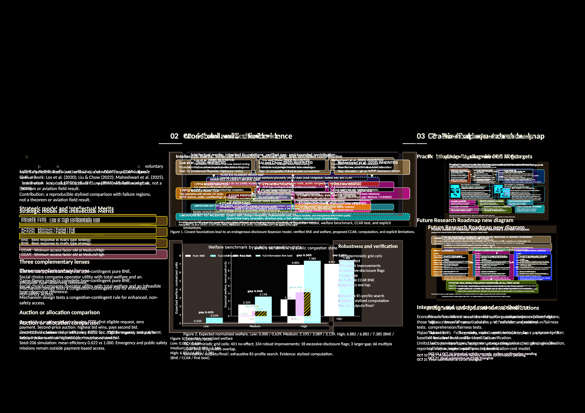

# Poster layout rebalance audit

Audit date: 2026-10-15, Asia/Shanghai. Baseline commit: `4794daf`. Scope: one-slide A0 poster geometry and synchronized poster deliverables only.

## Current section map

The poster canvas is `4493.86 × 3178.58` layout units, corresponding to A0 landscape (`1189 × 841 mm`). The main body occupies approximately `y=1000–2830`, followed by the fixed footer band.

| Region | Current geometry | Approximate body share | Content density |
| --- | ---: | ---: | --- |
| Section 01 | `x=140`, `w=1160` | 28.9% | Medium: question, model cards, lenses, allocation comparison |
| Section 02 | `x=1400`, `w=1693.86` | 42.2% | High: evidence chain, welfare figure, robustness and verification text |
| Section 03 | `x=3193.86`, `w=1160` | 28.9% | Medium: impact figure, roadmap, integration, dates |

The header, key-message band, footer, institutional logo, acknowledgments, references, open-material links, and QR codes already form a stable frame and are outside the rebalance scope.

## Observed imbalance

- Section 02 carries the highest information density but still uses the template's original center-column width. Its Intellectual Merits asset nearly fills a `1664 × 490` container, leaving no internal room to enlarge the evidence flow without reallocating the column itself.
- The Section 02 upper figure, caption, welfare panel, and long evidence caption are stacked. Caption bands consume 410 vertical units, so figure and evidence explanation compete instead of supporting one another.
- The welfare image is 16:9 inside a much wider panel. `contain` fitting leaves unused horizontal space even while its verification text is crowded below.
- Section 03 gives substantially more visual weight to the roadmap than to the practical-impact figure, although the two are peer supporting figures.
- Section 01 and Section 03 retain comfortable outer margins and several generous vertical gaps that can be tightened without reducing body font sizes.

## Rebalance strategy

- Reallocate the body grid to approximately 26.6% / 46.9% / 26.5%: Section 01 width `1080`, Section 02 width `1900`, Section 03 width `1074`, with two consistent `80`-unit gutters.
- Increase the Section 02 evidence panel to approximately `1900 × 575`. The embedded evidence chain grows by about 30% in displayed area while preserving its aspect ratio and canonical source.
- Convert Section 02's lower region into a chart-plus-evidence row: the welfare visualization occupies a near-16:9 left panel, while the unchanged numerical and verification content becomes a directly associated right caption block.
- Tighten caption spacing and low-density vertical gaps; do not reduce important body fonts to preserve the old geometry.
- Equalize the visual emphasis of the two Section 03 diagrams by enlarging Practical Impacts and modestly tightening the roadmap footprint.
- Tighten Section 01's vertical rhythm while preserving every model card and all explanatory text.

## Affected regions

- All three main-column widths, headings, rules, and internal content bounds.
- Section 01 internal vertical spacing and model-card width.
- Section 02 figure, caption, welfare panel, and evidence-caption relationship.
- Section 03 supporting-figure proportions and downstream vertical alignment.

## Non-affected regions

- Title, author, team code, course line, institution logo, key message, footer rule, acknowledgments, references, artifact URLs, QR destinations, and slide dimensions.
- Scientific model, Bayesian game structure, CCAR definition, numerical results, robustness counts, closest papers, SDG associations, conclusions, limitations, notebooks, paper, and web application.

## Acceptance checks

The revised poster must remain one editable A0 landscape slide; pass package, layout, font, and artifact-import validation; show no clipping or overlap; retain readable QR codes and all required content; synchronize stable and Canvas PPTX/PDF outputs; and visually improve both the local Section 02 flow and the poster-wide balance.

## Verified outcome

- Final body allocation is `1080 / 1900 / 1074` layout units, or approximately 26.6% / 46.9% / 26.5% of the three-column body.
- The Section 02 evidence image container increased from `1664 × 490` to `1870 × 565`, a 29.6% displayed-area increase. Its canonical image and scientific wording are unchanged.
- The lower evidence region now uses a near-16:9 welfare panel plus a directly associated robustness-and-verification column. No body text was reduced merely to preserve the old proportions.
- Practical Impacts gained visual area while the roadmap was modestly tightened; both remain readable and retain their original source assets.
- Final PowerPoint validation reports one slide, exact A0 dimensions, Calibri-only template typography, zero package findings, zero layout findings, full template-family coverage, and successful first-party re-import.
- The final PDF is one `3370.39 × 2383.94 pt` A0 page. Its PNG render is `3371 × 2384` pixels.
- Full-poster pixel comparison found 1,541,884 changed pixels inside the intended main-body rebalance region and exactly zero changed pixels outside it. The header/key-message region and footer are byte-identical before and after.
- Stable and Canvas PPTX files are byte-identical; stable and Canvas PDF files are also byte-identical.

## Before and after evidence

Full poster before:

Full poster after:

Section 02 before:

Section 02 after:

Changed-region diagnostic:

## Remaining manual checks

Open the final PPTX in Microsoft PowerPoint to confirm native font rendering, QR scanning, hyperlinks, and print preview. Inspect the final PDF at 100%, approve scientific wording and authorship details, and upload the two poster deliverables from `submission/final/` to Canvas.
